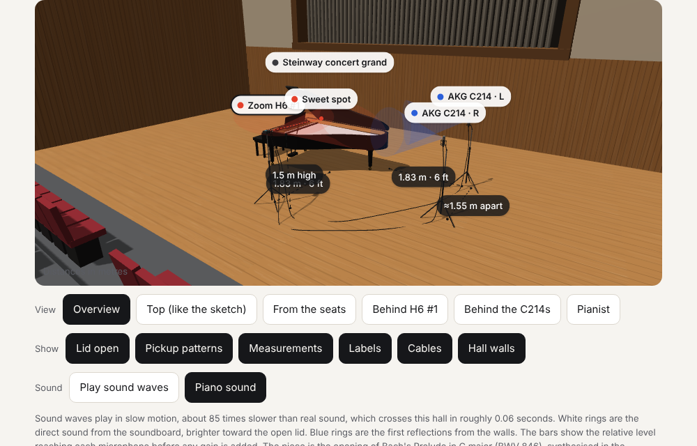
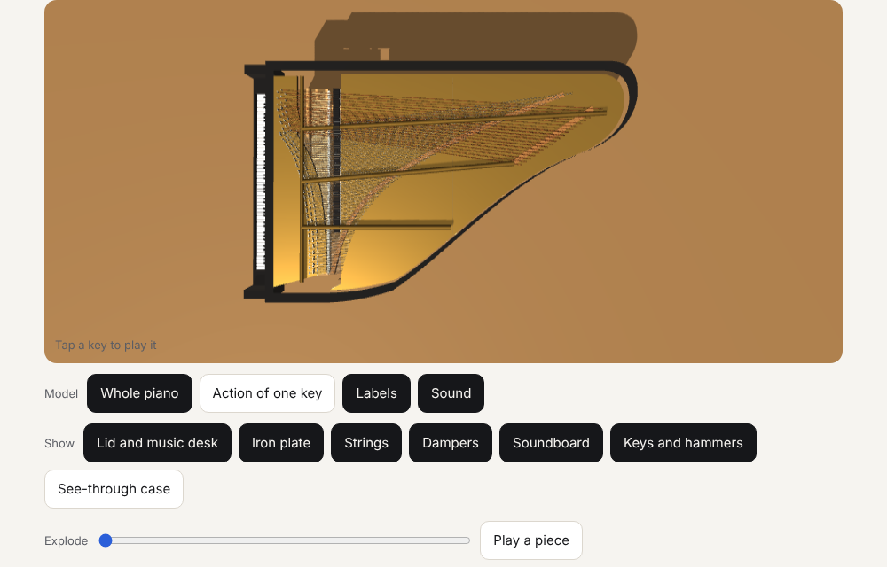
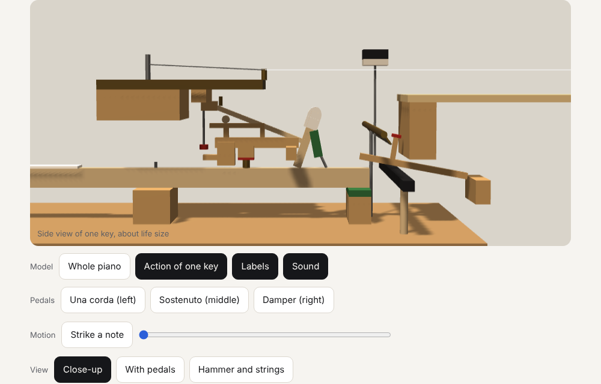
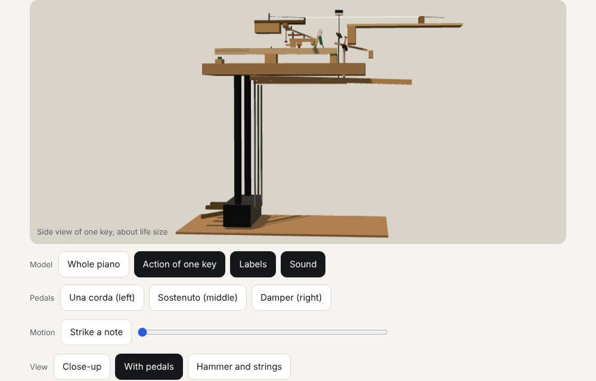

# Piano Recording

**[Open the web app](https://shanem73.github.io/piano-recording/)** · **[Read the instructions](https://shanem73.github.io/piano-recording/guide.html)** · **[Look inside the piano](https://shanem73.github.io/piano-recording/piano.html)**

An interactive 3D layout of a solo piano recording setup, built for students to follow.
The scene shows the C. Minor Recital Hall (Ellis 220, Missouri State University) with a
Steinway concert grand, two Zoom H6 recorders and a pair of AKG C214 microphones.

## The web app

`index.html` is the whole app: one self-contained page. It loads three.js from a CDN,
so it needs an internet connection but no build step.

- **Run it locally:** open `index.html` in a browser.
- **Host it:** turn on GitHub Pages for this repository (Settings > Pages, deploy from
  the `main` branch, root folder). The page is then served at
  `https://shanem73.github.io/piano-recording/`.

What the page does:

- Available in English, Simplified Chinese, Traditional Chinese and Korean, with a language switch at the top of both pages.
- Tap the piano to open the second page, with the 3D model of the piano and its action.
- An Instructions page (`guide.html`) carries the full setup and DaVinci Resolve guide in all four languages, with a contents list linking each step. A menu at the top of every page moves between the three pages.
- Orbit, zoom and tap any microphone for its role, height, distance and aim.
- One-tap views: overview, top (like the original sketch), from the seats, behind each
  microphone, and the pianist's view.
- Toggles for the piano lid, pickup fields, measurements, labels, cables and hall walls.
- "Play sound waves": a slow-motion simulation of sound leaving the soundboard,
  reflecting off the walls and reaching each microphone, with a level meter per channel.

## Inside the piano

`piano.html` is a second page: a concert grand you can open up, and one key's action in slow motion.

- **Whole piano:** case and braces, soundboard with ribs and bridges, cast-iron plate, 236 strings with the bass strings crossing over the tenor, tuning pins, dampers, 88 hammers and keys. Hide any layer, make the case see-through, or pull the layers apart with the Explode slider. Tap a key to play it and watch its key, hammer, damper and strings move.
- **Action of one key:** key, capstan, wippen, jack, let-off button, repetition lever, knuckle, hammer, backcheck, damper lever, damper and three strings, animated through one key stroke. Play it or step through it with the slider.
- **Pedals:** all three work in both views. The damper pedal lifts every damper through its rod, trap lever, pitman and tray. The sostenuto pedal holds only the dampers that are already up. The una corda pedal slides the keyframe so each hammer misses the left string of three.

The action uses Steinway's published regulation distances for the Model D (key dip 0.400 in, hammer blow 1-7/8 in, let-off 1/16 in, checking 15 mm) and lever lengths measured by piano technicians (17 mm knuckle, 130 mm shank, 62.5 and 93 mm wippen arms, 0.5 key ratio). The page lists every figure with its source. Part outlines, the key length and the pedal linkage under the keybed are simplified and are not Steinway drawings.

## The setup

Three stereo pairs, six audio tracks, every microphone 1.5 m above its floor.

| Recorder | Track | Source | Role |
| --- | --- | --- | --- |
| H6 #1 | L/R | X/Y capsule at 120°, aimed at the sweet spot | Main stereo image |
| H6 #1 | Input 3 | AKG C214 L (bass side) | Spaced pair, left |
| H6 #1 | Input 4 | AKG C214 R (treble side) | Spaced pair, right |
| H6 #2 | L/R | X/Y capsule at 120°, facing the back of the hall | Hall reverb |
| Camera | Built-in audio | Camera microphone | Sync reference only |

- H6 #1 stands 6 ft (1.83 m) out from the curved side of the piano, shifted slightly
  toward the tail.
- The C214 pair stands 6 ft beyond the tail, 1.5 to 1.6 m apart.
- H6 #2 stands in the seat zone.
- Inputs 3 and 4 are both on the right side of H6 #1, with 3 above 4.

In editing (DaVinci Resolve), every H6 track is synchronised by waveform to the
camera's sound track, the left/right channels are arranged, levels are balanced, and
the result is exported as a video with a stereo mix.
The step-by-step instructions for both parts are on the [Instructions page](https://shanem73.github.io/piano-recording/guide.html), and as Markdown in [English](GUIDE.md), [Simplified Chinese](GUIDE.zh-Hans.md) and [Korean](GUIDE.ko.md).

## Accuracy

The piano, microphones and recorders are modelled to their real sizes. The hall is
approximate: its capacity (about 250), raked seating, organ behind the platform and
wood side walls follow published descriptions, but its exact dimensions and finishes
are not published. The sound-wave simulation is a teaching cartoon, not an acoustic
model: it shows the direct sound and the first wall reflections only.

## License

MIT. See `LICENSE`.
